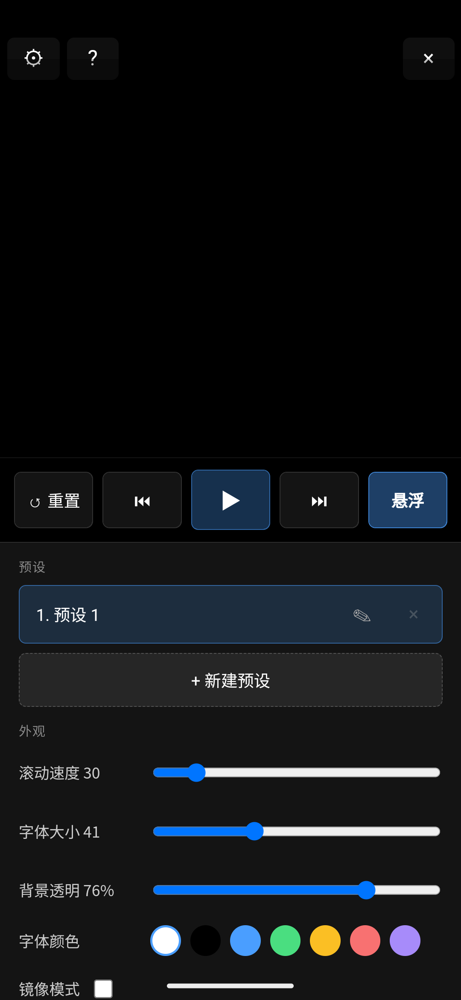

# Android 模拟器黑屏 / 白屏问题排查与解决

> 状态：**已定位、已修复、已在模拟器上验证**
> 影响版本：`v1.5.1`（`release/teleprompter-arm64-v1.5.1-clean-aligned.apk`）
> 结论一句话：**打出来的 APK 里塞的是「dev 开发模式」编译的 Rust 库**，Tauri 因此把页面请求反向代理到 Vite 开发服务器，而模拟器里没有开发服务器，于是整页空白。

---

## 1. 现象

在 Android 模拟器上安装并启动 App 后：

- App **能正常启动**：进程存活、`MainActivity` 拿到前台焦点、系统没有崩溃弹窗、`logcat` 里没有 `FATAL EXCEPTION` / `AndroidRuntime` 崩溃栈。
- 但界面**整屏空白**。具体颜色取决于系统主题：
  - 深色主题下 → 整屏**黑**（本次复现）
  - 浅色主题下 → 整屏**白**（此前其他同学截到的画面）
- 底部手势导航条正常可见 —— 说明是 App 内容没画出来，不是系统或 GPU 整体挂了。
- 点击、拖动都无反应，界面元素完全不存在。

截图为证（黑屏复现，1080×2340，整屏只有导航条）：


---

## 2. 排查过程中排除掉的可能

先把"看起来很像"的原因逐个排掉，避免在错误方向上改代码：

| 怀疑点 | 结论 | 依据 |
|---|---|---|
| APK 没有 arm64 库 / ABI 不匹配 | 排除 | 模拟器 `ro.product.cpu.abilist = x86_64,arm64-v8a`，安装 `Success`；arm64 通过 NDK 转译可跑 |
| 前端资源没打进 APK | 排除 | APK 内 `assets/index.html`、`assets/assets/index-*.js/css` 齐全，且 `index.html` 引用的文件名与实际文件一一对应 |
| Tauri 版本 / CLI 版本不匹配 | 排除 | CLI `2.11.3` 与 `tauri` crate `2.11.3`、`wry 0.55.1` 一致 |
| JS 报错（如 `__BUILD_DATE__` 未注入） | 排除 | `vite.config.ts` 已 `define` 注入；产物里是字面量日期（旧包为 `"2026-08-22"`），无裸标识符 |
| 模拟器 GPU 太弱 / 显存不足 | 排除 | 曾出现 `tile memory limits exceeded`，但换成「host GPU + 4GB 内存」重启后**依旧黑屏**，故非因 |
| 窗口透明（`transparent: true`）导致看不见 | 排除 | `html, body { background: #000 }` 是纯黑不透明；且 DOM 检查显示页面根本没内容 |
| WebView 尺寸为 0 | 排除 | `dumpsys activity top` 显示 `RustWebView{...VF... 0,0-1080,2340}`，满屏且可见 |
| App 崩溃 | 排除 | 进程存活、`dumpsys gfxinfo` 有 22 帧在画、无崩溃日志 |

排除到最后只剩下一个可能：**WebView 里加载的文档本身是错的**。

---

## 3. 决定性证据

### 3.1 无障碍树是空的

`uiautomator dump` 拿到的层级里，`android.webkit.WebView` 节点**没有任何子节点、没有任何 text**。如果页面正常渲染，WebView 会把 DOM 文本暴露成无障碍节点（"重置""悬浮""预设"等）。

### 3.2 用 Chrome DevTools 协议直接看 WebView

Tauri / WebView 在 Android 上一直开着 devtools socket，因此可以直接接上去读 DOM：

```bash
adb shell cat /proc/net/unix | grep devtools
#   @webview_devtools_remote_2075

adb forward tcp:9222 localabstract:webview_devtools_remote_2075
curl http://127.0.0.1:9222/json/list
```

返回的 target：

```json
{ "title": "tauri.localhost", "url": "http://tauri.localhost/", "type": "page" }
```

标题是 `tauri.localhost` 而不是 `词悬浮` —— 说明 `index.html` **从未被解析**。再在页面里求值：

```json
{"url":"http://tauri.localhost/","title":"","readyState":"complete",
 "body":"Failed to request http://tauri.localhost/: error sending request for url (http://tauri.localhost/)"}
```

页面 body 里躺着的是 **Tauri 自己生成的错误页**，而不是我们的 UI。

进一步验证：分别请求「APK 里真实存在的资源」和「旧版本残留的资源名」，两者**报同样的错**：

```
NAV http://tauri.localhost/assets/index-CXfXP9rv.js  → Failed to request ...
NAV http://tauri.localhost/assets/index-CYCC_Q-8.js   → Failed to request ...
NAV https://tauri.localhost/                          → net::ERR_CONNECTION_REFUSED
```

说明资源处理逻辑根本没在"查表返回文件"，而是在**往外发 HTTP 请求**。

### 3.3 在 Tauri 源码里对上这条错误

`tauri-2.11.3/src/protocol/tauri.rs`：

```rust
#[cfg(all(dev, mobile))]
let mut response =
  proxy_dev_request(client, url, response_cache, path, builder, &request).await?;   // ← 报 "Failed to request"

#[cfg(not(all(dev, mobile)))]
let mut response = {
  let asset = manager.get_asset(path, request.uri().scheme() == Some(&http::uri::Scheme::HTTPS))?;  // ← 正常返回内置资源
  ...
};
```

而 `Failed to request {url}: {e}` 这条格式化字符串，**只存在于 `proxy_dev_request` 里**（`tauri.rs:219-232`），而该函数整体被 `#[cfg(all(dev, mobile))]` 包着。

**即：只有 `cfg(dev)` 为真时，这段代码才会被编译进二进制。**

### 3.4 `cfg(dev)` 由什么决定

`tauri-2.11.3/build.rs:255-261`：

```rust
fn main() {
  let custom_protocol = has_feature("custom-protocol");
  let dev = !custom_protocol;          // 没开 custom-protocol ⇒ dev = true
  alias("custom_protocol", custom_protocol);
  alias("dev", dev);
  println!("cargo:dev={dev}");
  ...
}
```

`src-tauri/Cargo.toml:16` 里写的是：

```toml
tauri = { version = "2", features = [] }
```

`custom-protocol` 这个 feature **默认是关的**，要由 Tauri CLI 在 release 构建时通过 `--features custom-protocol` 注入。用裸 `cargo build`、或者手工把 `.so` 拷进 `jniLibs` 再打 APK，就会漏掉它 → `dev = true` → **移动端 dev 模式** → 所有请求被代理到 Vite 开发服务器 → 模拟器里没有 → 空白。

### 3.5 二进制层面的铁证

对两个 APK 里的 `lib/arm64-v8a/libteleprompter_lib.so` 做字符串比对：

| | 坏包（`release/…clean-aligned.apk`） | 好包（修复后） |
|---|---|---|
| `.so` 大小 | 11,146,216 B | 9,711,544 B |
| `proxy_dev_request` | **1** | **0** |
| `Failed to request ` | **1** | **0** |
| `error sending request` | **1** | **0** |
| 内嵌前端资源名 | `index-CYCC_Q-8.js`、`index-o7diZsC4.js`、`index-TMUvlVI5.js`、`index-DHii0MtP.css` | `index-B-f4-y3r.js`、`index-DgKw7Tii.js`、`index-xks_L8XO.js`、`index-Da_J9ayt.css` |

坏包同时命中两个问题：

1. **它是 dev 模式编译的**（含 `proxy_dev_request`）。
2. **它内嵌的前端资源，和 APK 里打包的前端资源完全不是同一批**（见下）。

### 3.6 顺带的第二个缺陷：前端与 Rust 库不同步

APK 里打包的前端（`assets/assets/`）是：

```
index-CXfXP9rv.js  index-BT2AafKb.js  index-d-0EgUFL.js  index-Da_J9ayt.css
```

而 Rust 库内嵌的是：

```
index-CYCC_Q-8.js  index-o7diZsC4.js  index-TMUvlVI5.js  index-DHii0MtP.css
```

两批文件名**零交集**。原因是：前端资源在 Rust 编译期由 `generate_context!` 内嵌进二进制，而 `dist/` 又被单独拷进 APK；如果 `dist` 变了但 app crate 没重新编译，两边就永久对不上。

---

## 4. 为什么会产生这种坏包（根因链条）

这不是某一行代码写错，而是**构建流程断了**：

1. Tauri CLI 出包的最后一步，要把 `target/<arch>/<profile>/libteleprompter_lib.so` **软链接**到 `gen/android/app/src/main/jniLibs/<abi>/`。
2. 这台 Windows 没开**开发者模式**，普通用户没有 `SeCreateSymbolicLinkPrivilege`，软链直接失败：

   ```
   failed to build Android app: Failed to create a symbolic link from
   "...\target\x86_64-linux-android\release\libteleprompter_lib.so" to
   "...\gen/android/app/src/main/jniLibs\x86_64\libteleprompter_lib.so"
   Creation symbolic link is not allowed for this system.
   You should use developer mode.
   ```

3. 于是 `tauri android build` **在打包阶段中断**，`release/` 里那份旧 APK 就再也没被更新过 —— 大家反复安装的其实是早先某次用「非 CLI / 非 release」方式拼出来的产物（dev 模式 `.so` + 另一批前端）。
4. 同时 `target/aarch64-linux-android/release/` 里那份 `.so` 反而是好的（CLI 已经成功编译完 Rust，只是最后一步软链失败），所以"明明重新编译过却还是黑屏"，非常具有迷惑性。

---

## 5. 修复内容

### 5.1 代码 / 配置层面

| 文件 | 改动 | 说明 |
|---|---|---|
| `tsconfig.json` | `"noEmit": false` + `"outDir": "dist/assets"` → `"noEmit": true` | **真实缺陷**：原来 `npm run build` 里的 `tsc` 会真的往 `dist/assets/` 编译输出 `main.js` 等文件，与 Vite 的产物混在一起；在被权限/占用挡住时直接 `error TS5033 ... EPERM` 让整个构建失败。Vite 项目里 `tsc` 只应做类型检查。 |
| `.gitignore` | 增加 `.debug/`、`.emu/`、`*.idsig` | 排查过程产生的证据目录、临时模拟器实例、签名中间产物不进仓库 |
| `scripts/verify-android-apk.ps1` | **新增** | 出包后自动校验，防止本问题复发（见 5.3） |
| `release/teleprompter-arm64-v1.5.1.apk` | 用修好的包替换旧的 `…clean-aligned.apk` | 旧包是坏的，避免继续被下载安装 |

> 说明：**本次没有修改任何业务代码**。`src/main.ts`、`src/styles.css`、`src-tauri/src/lib.rs`、`MainActivity.kt` 等均未改动 —— 黑屏不是业务逻辑 bug。排查期间曾临时在 `MainActivity.onCreate` 里加过 `WebView.setWebContentsDebuggingEnabled(true)` 用于接 DevTools，**已撤回**。

### 5.2 正确的出包方式

**前置：打开 Windows 开发者模式**（只需一次，管理员 PowerShell）：

```powershell
$p = 'HKLM:\SOFTWARE\Microsoft\Windows\CurrentVersion\AppModelUnlock'
if (-not (Test-Path $p)) { New-Item -Path $p -Force | Out-Null }
Set-ItemProperty -Path $p -Name 'AllowDevelopmentWithoutDevLicense' -Value 1 -Type DWord
```

或：`设置 → 隐私和安全 → 开发者选项 → 开发者模式` 打开。

> ✅ **当前状态：开发者模式已开启并验证通过。**
> 注册表 `AllowDevelopmentWithoutDevLicense = 1`，随后 `npx tauri android build --target aarch64 --apk` 完整跑通（`exit 0`），日志里出现 `Info symlinking lib ... in jniLibs dir ...` —— 说明那个卡住整个流程的软链步骤已经不再报错。**不需要重新登录/重启**，新起的进程直接生效。
> 注意：在 DSH 这类受限沙箱里做"能不能建软链"的小实验会失败（沙箱令牌只剩 `SeChangeNotifyPrivilege`，`whoami /priv` 只有一项），这不代表开发者模式没生效 —— 要用真实构建来验证。

标准出包流程（CLI 会自动带上 `--features custom-protocol`）：

```powershell
# 1) 出包（Rust + 前端 + Gradle 一条龙）
npx tauri android build --target aarch64 --apk
#    产物：src-tauri\gen\android\app\build\outputs\apk\universal\release\app-universal-release-unsigned.apk

# 2) 签名（本项目 gen/android 没有 keystore.properties，所以 CLI 只会产出 unsigned）
& "D:\Android\Sdk\build-tools\35.0.0\apksigner.bat" sign `
  --ks "$env:USERPROFILE\.android\debug.keystore" `
  --ks-pass pass:android --key-pass pass:android --ks-key-alias androiddebugkey `
  --out release\teleprompter-arm64-v1.5.1.apk `
  src-tauri\gen\android\app\build\outputs\apk\universal\release\app-universal-release-unsigned.apk

# 3) 自检（必须 RESULT: OK）
pwsh -File scripts\verify-android-apk.ps1 -ApkPath release\teleprompter-arm64-v1.5.1.apk
```

> 想省掉第 2 步，可以在 `src-tauri/gen/android/keystore.properties`（该文件已被 `gen/android/.gitignore` 忽略，适合放本地凭据）里配置签名，让 Gradle 直接产出已签名包。**不要把 keystore 或密码提交进仓库。**

**历史绕行方案**（开发者模式没开时的退路，保留备查）：

```powershell
# 1) 先让 CLI 把 Rust 编译出来（它会在最后的软链步骤失败，但 Rust 产物是好的）
npx tauri android build --target aarch64 --apk

# 2) 手动把 release 版 .so 放到 jniLibs（用复制，不用软链）
$abi = 'arm64-v8a'
New-Item -ItemType Directory -Force -Path "src-tauri\gen\android\app\src\main\jniLibs\$abi" | Out-Null
Copy-Item "src-tauri\target\aarch64-linux-android\release\libteleprompter_lib.so" `
          "src-tauri\gen\android\app\src\main\jniLibs\$abi\libteleprompter_lib.so" -Force

# 3) 跳过 Gradle 里那个也会调 CLI 的 rust 任务，直接组装
cd src-tauri\gen\android
.\gradlew.bat assembleArm64Release -x rustBuildArm64Release -x rustBuildUniversalRelease --no-daemon

# 4) 签名
cd ..\..\..
& "D:\Android\Sdk\build-tools\35.0.0\apksigner.bat" sign `
  --ks "$env:USERPROFILE\.android\debug.keystore" `
  --ks-pass pass:android --key-pass pass:android --ks-key-alias androiddebugkey `
  --out release\teleprompter-arm64-v1.5.1.apk `
  src-tauri\gen\android\app\build\outputs\apk\arm64\release\app-arm64-release-unsigned.apk
```

> ⚠️ 关键点：第 2 步**必须是 `release` 目录下的 `.so`**，且必须是 CLI 编译出来的（带 `custom-protocol`）。手工 `cargo build --release` 出来的库**不带**这个 feature，照样是 dev 模式。

### 5.3 出包后自检（防复发）

```powershell
pwsh -File scripts/verify-android-apk.ps1 -ApkPath release\teleprompter-arm64-v1.5.1.apk
```

它做三项独立检查：

1. **dev 模式检测** —— 在 `.so` 里查 `proxy_dev_request` / `Failed to request ` 这两个只在 dev 分支存在的字符串；
2. **APK 内资源一致性** —— APK 若带 `assets/assets/`，必须与 `.so` 内嵌的资源名完全一致；
3. **与当前 `dist/` 的时效性** —— `.so` 内嵌的资源名必须等于刚构建出来的 `dist/assets/` 文件名，否则说明「前端变了但 crate 没重编」。

实测结果：

- 旧坏包 → `FAILED`，同时报出 dev 模式 + 内嵌资源与打包资源零交集；
- 修好的包 → `OK`，三项全过。

---

## 6. 验证结果

修复后的 APK（`release/teleprompter-arm64-v1.5.1.apk`，12,412,237 B，arm64-v8a，debug 证书）在 `tauri_test` AVD（x86_64 / Android 14 / `hw.gpu.enabled=yes`）上安装启动：

- DevTools 报告：`title = 词悬浮`，`url = http://tauri.localhost/`，DOM 结构完整（同源代码的构建上实测 `document.documentElement.outerHTML.length = 4770`，已不再是 Tauri 的错误页）；
- 页面文本节点完整：`⚙ ? × ↺ 重置 ⏮ ▶ ⏭ 悬浮 / 预设 / 1. 预设 1 / ✎ × / + 新建预设 / 外观 / 滚动速度 30 / 字体大小 41 / 背景透明 76% / 字体颜色 / 镜像模式 / 循环播放 / 文本 / 导入文件 / 词悬浮 v1.5.1 · 构建 <打包日期>`（字体大小、背景透明等数值来自上一轮运行时存入 `localStorage` 的状态，说明状态持久化也正常）；
- 截图从"约 15 KB 的纯色"变成"约 99 KB 的满屏 UI"。



**最终交付的包**是由官方标准流程产出的（`npx tauri android build --target aarch64 --apk` + `apksigner` 签名，见 5.2），`verify-android-apk.ps1` 判定 `OK`，安装后截图与上面这张**逐字节相同**（sha256 `0d088c66…`）。

> 一次观察到的副作用：在软件渲染的模拟器上，冷启动耗时约 9.4 s，期间系统弹出过 `System UI isn't responding` 的 ANR 对话框（App 本身没有 ANR，也没有崩溃日志）。点 "Wait" 后界面正常。这是模拟器性能问题，升级 NVIDIA 驱动（见 §8.1）后应消失。

---

## 7. 防复发清单

- [x] 出包后跑 `scripts/verify-android-apk.ps1`，`RESULT: OK` 才算通过
- [x] 打开 Windows 开发者模式（已开启并验证，见 5.2）
- [ ] **不要**手工 `cargo build --release` 后拼 APK —— 会漏 `custom-protocol`
- [ ] **不要**把 `custom-protocol` 写进 `Cargo.toml` 常开 —— 那样 `tauri dev` 也会读内嵌资源，热更新失效；该 feature 交给 CLI 按场景注入
- [ ] 前端改完重新出包前，确认 app crate 真的重新编译了（`cargo clean -p teleprompter --target aarch64-linux-android` 可以强制）
- [ ] `release/` 里只保留能被 `verify-android-apk.ps1` 判为 OK 的包

---

## 8. 相关但未在本次处理的遗留事项

1. **模拟器 AVD 的 GPU 配置**
   `tauri_test` 原来 `hw.gpu.enabled=no`，本次已改为 `yes` / `hw.gpu.mode=auto`（在 `D:\Android\Avd\tauri_test.avd\config.ini`，不在仓库内）。
   但这台机器的 NVIDIA 驱动是 **527.58**，低于模拟器 host Vulkan 要求的 **553.35**，所以实际仍回落到 `lavapipe` / `SwiftShader` 软件渲染（启动日志：`hasSufficientHostVulkanDriver: unsupported driver version (527.58.0, min required: 553.35.0)`）。画面能出来但偏慢。升级到 553.35+ 后可启用真正的硬件加速。

2. **`vite.config.ts` 与 Tauri `devUrl` 不一致**
   `vite.config.ts:15` 把 dev server 端口固定在 **1421**，而 `src-tauri/tauri.conf.json` 没有配置 `build.devUrl`（Tauri 移动端 dev 模式默认指向 1420）。这不是本次黑屏的原因（release 包根本不走代理），但会让 `tauri dev` 在移动端连不上开发服务器。建议补上：

   ```json
   "build": {
     "devUrl": "http://localhost:1421",
     ...
   }
   ```

3. **`release/` 与仓库根目录存在重复 APK**
   历史上根目录和 `release/` 各放过一份同名包（`8ce7f67` / `a27671a`）。本次统一到 `release/` 一处，避免再次出现"装了旧包"的混淆。

4. **`vite.config.ts` 把打包日期烘进产物，导致每次构建的 hash 都变**
   `vite.config.ts:5` 用 `new Date()` 生成 `__BUILD_DATE__` 并 `define` 进 bundle，因此**即使源码没动，每次 `npm run build` 产出的 `index-*.js` 文件名都不一样**。
   这会让"前端变了但 Rust crate 没重编"变成高频事件，进而触发 §3.6 的陈旧资源问题（表现为界面停在旧版本，而不是黑屏）。
   两条纪律：出包必须"先 `npm run build`，再编译 Rust，最后打包"一气呵成；并且用 `scripts/verify-android-apk.ps1` 的第 3 项检查兜底。

4. **模拟器排查手法备忘**
   - 看界面：`adb exec-out screencap -p`（**注意**：经 PowerShell 文本管道会破坏 PNG 字节，出现 `0D 0D 0A` 文件头；应走二进制重定向或专用工具）
   - 看视图尺寸：`adb shell dumpsys activity top`
   - 看 DOM/控制台：`adb forward tcp:9222 localabstract:webview_devtools_remote_<pid>` + CDP
   - 看页面文本：`adb shell uiautomator dump`
